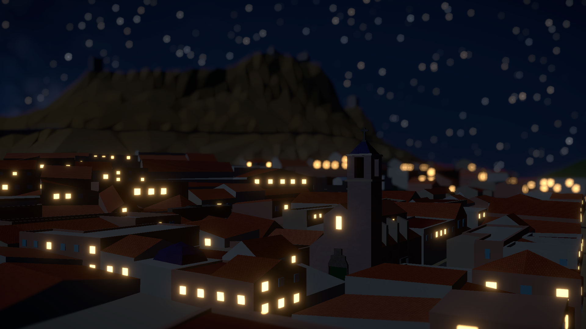
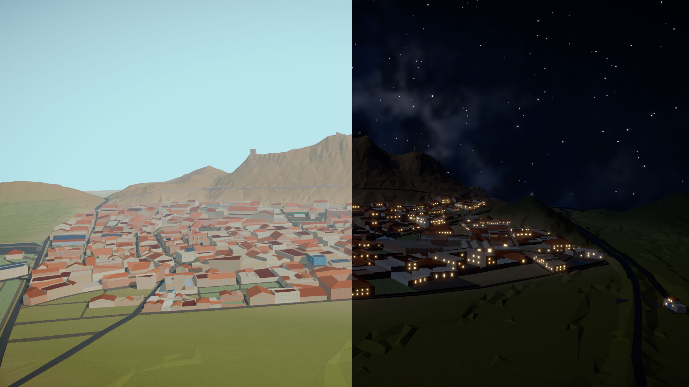

# Almenara · Diorama turístico 3D low-poly

**Español** · [English](#english)

[](https://erpepinomarino.github.io/low_poly_map_tour/)
[](https://react.dev/)
[](https://threejs.org/)
[](https://www.typescriptlang.org/)

<p align="center">
  
</p>

## Español

Este proyecto solo tiene un objetivo, y es tremendamente simple: **trastear con Three.js y descubrir si era capaz de montar una escena 3D con +50k polígonos, DOF, una UI, sombras, bloom y antialiasing, y conseguir que la escena fuera fluida hasta en mi smartphone (que es malo)**.

El resultado es un diorama low-poly de **Almenara (Castellón), España** que podría funcionar como mapa turístico interactivo. No obstante, visto el resultado, puede adaptarse fácilmente a muchos otros tipos de proyecto: ferias, parques de atracciones, presentaciones inmobiliarias, museos... Básicamente, cualquier experiencia que necesite un mapa 3D navegable con puntos de interés.

Es un **proyecto gratuito**, hecho por gusto y sin ningún tipo de colaboración con el Ayuntamiento de Almenara. No es una herramienta oficial ni una representación cartográfica de precisión: es un experimento divertido y una pieza de portfolio.

**¡Prueba la demo!** [erpepinomarino.github.io/low_poly_map_tour](https://erpepinomarino.github.io/low_poly_map_tour/)

### Cómo he tratado de huir de la típica experiencia vibecodeada

Lo que tenía claro desde un primer momento es que no quería un resultado genérico. Por eso, tanto las decisiones técnicas y artísticas, el modelado, la optimización de mallas, la integración de sistemas, la dirección técnica y la depuración han sido mías. La IA, aunque ha sido un apoyo brutal, ha estado dirigida paso a paso (y me la ha liado más de una vez). No se ha usado como un generador autónomo que haya decidido el proyecto por mí, ew.

Lo más duro:

- **Modelado:** construí a mano los modelos low-poly del pueblo y de los 12 POIs en Blender.
- **Optimización:** reduje la malla del terreno desde casi 200.000 triángulos hasta el entorno de los 15.000, además de cuidar polígonos, UVs, normales y materiales.
- **Desarrollo:** Three.js con React, estado, internacionalización, vuelos de cámara, materiales procedurales, efectos y responsive.
- **Depuración:** diagnóstico y corrección de bugs de render, cámara, materiales y comportamiento móvil.
- **Despliegue:** build de producción, GitHub Actions y GitHub Pages.

<p align="center">
  
</p>

### Tecnologías y para qué se usaron

| Tecnología                                                                                                 | Uso en el proyecto                                                                  |
| ---------------------------------------------------------------------------------------------------------- | ----------------------------------------------------------------------------------- |
|                         | Interfaz, HUD, fichas de POI y estado de la aplicación.                             |
|               | Tipado de POIs, estado global, planes de cámara y utilidades de la escena.          |
|                     | Motor 3D, geometría, luces, materiales, sombras, cámara y render.                   |
|                             | Integración declarativa de la escena Three.js con React.                            |
|                                                           | `OrbitControls`, carga de GLB, utilidades de cámara y recursos de escena.           |
|                                       | Bloom, DOF, viñeta y SMAA.                                                          |
|                                                     | Estado compartido: POI activo, panel, vuelos, efectos e idioma.                     |
|                                                     | Interfaz y contenido bilingüe ES/EN.                                                |
|                                 | Desarrollo y build de producción.                                                   |
|                      | Scripts de descarga, procesado de datos, color del terreno y preparación de assets. |
|                        | Modelado, remodelado, simplificación y exportación de mallas GLB.                   |
|  | Lint, build, validación y despliegue en GitHub Pages.                               |

### Desarrollo: cómo se hizo y por qué se nota

**a) Terreno desde un mapa topográfico**

La forma del terreno parte de datos topográficos reales. La malla inicial tenía cerca de 200.000 triángulos y el reto era conservar la lectura de la montaña y del casco urbano sin cargar el navegador. La optimización en Blender, con su magnífico Decimate, retriangulación y un poco de esculpido, la dejó alrededor de **15.000 triángulos**, con una silueta low-poly reconocible.

**b) Carreteras desde OpenStreetMap**

La red de calles y carreteras se extrajo de OpenStreetMap, pero no se usó tal cual: se simplificó, se remodeló y se adaptó a la escala y al lenguaje visual del diorama en Blender.

**c) Modelos hechos a mano**

Todos los modelos del pueblo y de los puntos de interés están modelados a mano en low poly en Blender. No son assets comprados ni modelos generados automáticamente: responden a decisiones de escala, silueta y legibilidad para funcionar a distancia de maqueta.

**d) Optimización sin depender de texturas**

Se evitó depender de texturas pesadas. La mayoría de materiales son patrones procedurales creados con código: piedra, teja, jardines, paneles solares, superficies deportivas, agua o fachadas. Todos reutilizados por nombre de material. El terreno usa color por vértices horneado y una textura de ruido ligera. Aquí es donde el poder de la IA más se nota, generando matemáticamente los patrones de tejas, ladrillos y piedras a base de ruido Voronoi.

**e) Resultado visual con coste controlado**

Se usaron materiales emisivos para las ventanas, sombras, antialiasing y postprocesado (bloom, profundidad de campo y viñeteado) buscando un acabado cuidado sin sacrificar la fluidez.

**f) Información técnica para cotillas**

La aplicación incluye un panel de información técnica con datos de cámara, distancias, altura del terreno, estado del DOF, estadísticas de escena y controles de depuración. No es necesario para usar el mapa, pero deja ver cómo funciona la escena por dentro.

### Un ejemplo de depuración real (que rompía el render)

Centrar un POI que ya estaba centrado podía generar una curva de cámara degenerada. El mapeo de distancias de Three.js devolvía `NaN`, la cámara perdía una posición válida y el canvas se quedaba en azul durante la animación. Se corrigió con modos de vuelo estático/lineal/Bézier, detección de curvas degeneradas y una guarda para no enviar nunca posiciones no finitas a la cámara.

### Funcionalidades principales

- 12 puntos de interés con ficha, categoría, descripción y fotografía.
- Vuelos de cámara cinematográficos con duración adaptativa de 2 a 6 segundos.
- Deep links: `?poi=castillo`, `?poi=estacion-tren`…
- Ciclo día/noche con hora real de Almenara o simulación manual.
- Iluminación nocturna progresiva en las ventanas.
- DOF automático con activación/desactivación progresiva, bloom, viñeta, niebla y SMAA.
- Interfaz responsive: panel lateral estrecho en vertical y ficha compacta en horizontal.
- Español e inglés, con detección automática del idioma del navegador.
- Panel de información técnica y controles de rendimiento.

### Ejecutar en local

```bash
npm install
npm run dev
npm run build
npm run preview
npm run lint
```

### Datos y regeneración

```bash
npm run fetch:dem       # elevación MDT05 del CNIG
npm run build:terrain   # genera el terreno low-poly
npm run prepare:lights  # prepara semillas de iluminación de ventanas
node scripts/colorize_terrain.mjs
```

El terreno y los modelos se editan en Blender. El color del terreno se hornea después con el script para no depender del exportador de Blender.

### Despliegue

La aplicación se publica en GitHub Pages. Cada push a `main` ejecuta lint, build y despliegue automático mediante GitHub Actions.

### Créditos y contexto

- Cartografía base: colaboradores de OpenStreetMap.
- Elevación: MDT05 del CNIG.
- Modelos, materiales y adaptación del proyecto: creados para este diorama.
- Proyecto personal, gratuito y sin vinculación con el Ayuntamiento de Almenara.

---

## English

[Español](#español) · **English**

This project has only one goal, and it is extremely simple: **to tinker with Three.js and find out whether I could build a 3D scene with 50k+ polygons, DOF, a UI, shadows, bloom and antialiasing, and keep it smooth even on my smartphone (which is bad)**.

The result is a low-poly diorama of **Almenara (Castellón), Spain** that could work as an interactive tourist map. However, given the result, it can easily be adapted to many other types of project: fairs, theme parks, real-estate presentations, museums... Basically, any experience that needs a navigable 3D map with points of interest.

It is a **free project**, made for fun and without any collaboration whatsoever with Almenara Town Council. It is not an official tool or a precision cartographic representation: it is a fun experiment and a portfolio piece.

**Try the demo!** [erpepinomarino.github.io/low_poly_map_tour](https://erpepinomarino.github.io/low_poly_map_tour/)

### How I tried to escape the typical vibe-coded experience

What I knew from the start was that I did not want a generic result. That is why both the technical and artistic decisions, the modelling, mesh optimisation, system integration, technical direction and debugging have been mine. AI, although it has been a huge support, has been directed step by step (and has messed me up more than once). It has not been used as an autonomous generator that made the project's decisions for me, ew.

The hardest parts:

- **Modelling:** I hand-built the low-poly models of the town and the 12 POIs in Blender.
- **Optimisation:** I reduced the terrain mesh from nearly 200,000 triangles to around 15,000, while also managing polygons, UVs, normals and materials.
- **Development:** Three.js with React, state management, internationalisation, camera flights, procedural materials, effects and responsive design.
- **Debugging:** diagnosis and fixes for rendering, camera, material and mobile-behaviour bugs.
- **Deployment:** production build, GitHub Actions and GitHub Pages.

### Technologies and what they were used for

| Technology                                                                                                 | Role in the project                                                         |
| ---------------------------------------------------------------------------------------------------------- | --------------------------------------------------------------------------- |
|                         | Interface, HUD, POI panels and application state.                           |
|               | Typed POIs, global state, camera plans and scene utilities.                 |
|                     | 3D engine, geometry, lights, materials, shadows, camera and rendering.      |
|                             | Declarative Three.js scene integration with React.                          |
|                                                           | `OrbitControls`, GLB loading, camera utilities and scene resources.         |
|                                       | Bloom, DOF, vignette and SMAA.                                              |
|                                                     | Shared state: active POI, panel, flights, effects and language.             |
|                                                     | Spanish/English UI and content.                                             |
|                                 | Development and production build.                                           |
|                      | Download scripts, data processing, terrain colouring and asset preparation. |
|                        | Modelling, remodelling, simplification and GLB mesh export.                 |
|  | Lint, build, validation and GitHub Pages deployment.                        |

### Development: how it was made and why it stands out

**a) Terrain from a topographic map**

The terrain shape comes from real topographic data. The initial mesh had nearly 200,000 triangles and the challenge was preserving the mountain and town silhouette without overloading the browser. Optimisation in Blender, with its magnificent Decimate, retriangulation and a bit of sculpting, brought it down to around **15,000 triangles**, with a recognisable low-poly silhouette.

**b) Roads from OpenStreetMap**

The street and road network was extracted from OpenStreetMap, but it was not used as-is: it was simplified, remodelled and adapted to the diorama's scale and visual language in Blender.

**c) Hand-made models**

All the town and points-of-interest models were hand-built in low poly in Blender. They are not purchased assets or automatically generated models: they reflect decisions about scale, silhouette and legibility so they work from a diorama viewing distance.

**d) Optimisation without relying on textures**

I avoided relying on heavy textures. Most materials are procedural patterns created in code —stone, roof tiles, gardens, solar panels, sports surfaces, water or façades— reused by material name. The terrain uses baked vertex colours and a lightweight noise texture. This is where the power of AI is most visible, mathematically generating tile, brick and stone patterns using Voronoi noise.

**e) Visual result with a controlled cost**

Emissive window materials, shadows, antialiasing and postprocessing (bloom, depth of field and vignetting) were used to achieve a polished look without sacrificing smoothness.

**f) Technical information for curious people**

The application includes a technical information panel with camera data, distances, terrain height, DOF status, scene statistics and debugging controls. It is not needed to use the map, but it shows how the scene works internally.

### A real debugging example (that broke the render)

Centring a POI that was already centred could generate a degenerate camera curve. Three.js distance mapping returned `NaN`, the camera lost a valid position and the canvas stayed blue during the animation. It was fixed with static/linear/Bézier flight modes, degenerate-curve detection and a guard to prevent non-finite positions from ever reaching the camera.

### Main features

- 12 points of interest with panel, category, description and photograph.
- Cinematic camera flights with adaptive duration from 2 to 6 seconds.
- Deep links: `?poi=castillo`, `?poi=estacion-tren`…
- Day/night cycle using Almenara's real time or manual simulation.
- Progressive night lighting on windows.
- Automatic DOF with progressive activation/deactivation, bloom, vignette, fog and SMAA.
- Responsive interface: narrow side panel in portrait and compact panel in landscape.
- Spanish and English, with automatic browser-language detection.
- Technical information panel and performance controls.

### Run locally

```bash
npm install
npm run dev
npm run build
npm run preview
npm run lint
```

### Data and regeneration

```bash
npm run fetch:dem       # CNIG MDT05 elevation
npm run build:terrain   # generates the low-poly terrain
npm run prepare:lights  # prepares window lighting seeds
node scripts/colorize_terrain.mjs
```

The terrain and models are edited in Blender. Terrain colour is baked afterwards with the script so it does not depend on Blender's exporter.

### Deployment

The application is published on GitHub Pages. Every push to `main` runs lint, build and automatic deployment through GitHub Actions.

### Credits and context

- Base cartography: OpenStreetMap contributors.
- Elevation: CNIG MDT05.
- Models, materials and project adaptation: created for this diorama.
- Personal, free project with no affiliation with Almenara Town Council.
